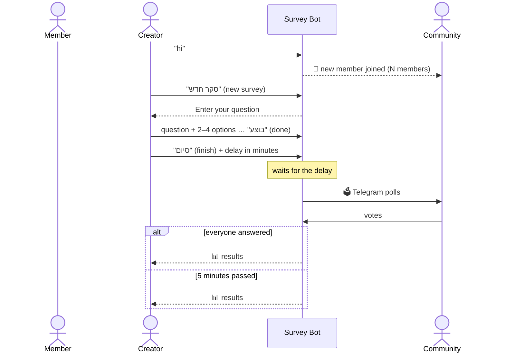
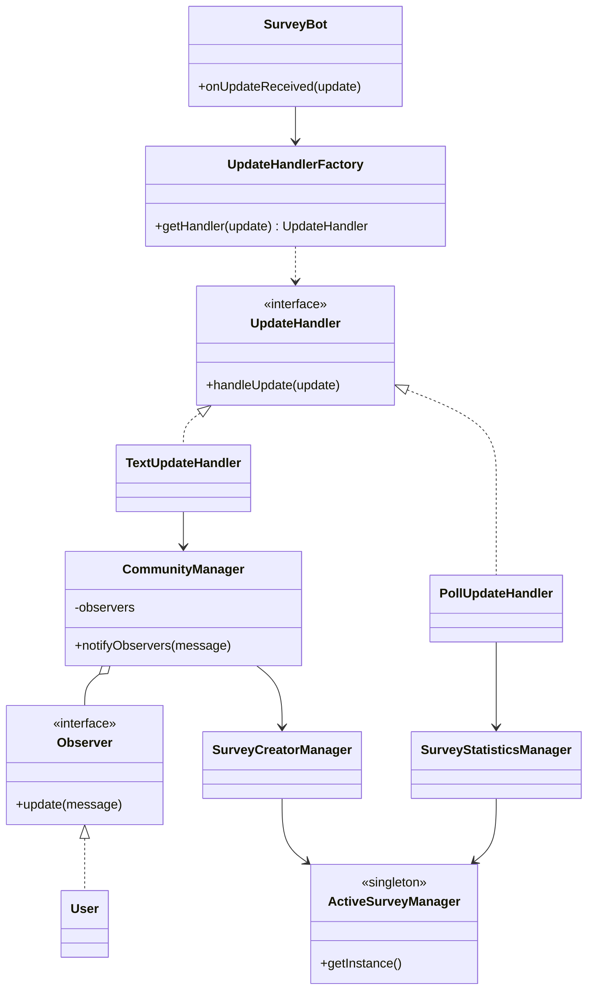

<div align="center">

# 📊 Telegram Survey Bot 2.0

**A community polling bot for Telegram: members join, one member at a time builds a survey, and the bot sends it to everyone, collects the votes and reports the results back.**

[](https://openjdk.org/)
[](https://core.telegram.org/bots/api)
[](https://github.com/rubenlagus/TelegramBots)
[](https://maven.apache.org/)
[](#-concurrency)

</div>

---

## 📌 Overview

Members join a shared community by messaging the bot. Any member can then become the **survey creator**: they write up to 3 questions with 2–4 answers each, choose a delay in minutes, and the bot broadcasts native Telegram polls to the whole community. Once everyone has voted — or after a 5-minute window — the creator receives a **results summary** and the bot is ready for the next survey.

## ✨ Features

- 👋 **Community sign-up** — send `hi` / `הי` to join; existing members are notified when someone new joins
- 🧑‍💻 **Guided survey builder** — step-by-step conversation for questions and options, with validation (2–4 unique options, 1–3 questions)
- 🔒 **One active survey at a time** — other members are told who is currently creating a survey and asked to wait
- 👥 **Minimum audience** — a survey can only be created once the community has at least 3 members
- ⏱️ **Scheduled sending** — the creator picks how many minutes from now the polls go out
- 🗳️ **Native Telegram polls** with vote tracking per user and per option
- 📈 **Automatic results** — sent to the creator as soon as all members answered, or after 5 minutes

## 🔄 How It Works



## 🏗️ Design



| Pattern | Where | Why |
|---|---|---|
| **Factory** | `UpdateHandlerFactory` | Routes each Telegram update (text message vs. poll answer) to the right handler |
| **Strategy / polymorphism** | `UpdateHandler` → `TextUpdateHandler`, `PollUpdateHandler` | New update types can be added without touching the bot class |
| **Observer** | `CommunityManager` ↔ `User implements Observer` | Broadcasts community events to every member |
| **Singleton** | `ActiveSurveyManager` | A single source of truth for "who is creating a survey right now" |

### 🧵 Concurrency

The bot serves many users at once, so shared state is protected explicitly: the active-survey singleton uses a `synchronized` accessor, poll metadata lives in a synchronized map, and a background thread watches the clock and closes the survey when the time window ends. Delayed sending runs on its own thread so the bot keeps answering other users while it waits.

## 🚀 Getting Started

**Prerequisites:** Java 22, Maven, and a bot token from [@BotFather](https://t.me/BotFather).

1. Clone the repo:
   ```bash
   git clone https://github.com/shaiberkov/TelegramSurveyBot2.0.git
   cd TelegramSurveyBot2.0
   ```
2. Create `src/main/resources/config.properties` (it is not committed):
   ```properties
   BOT_TOKEN=123456789:your-bot-token
   ```
3. Run `org.example.Main` from your IDE, or:
   ```bash
   mvn compile exec:java -Dexec.mainClass=org.example.Main
   ```

## ⚙️ Configuration

All limits live in `Constants.java`:

| Constant | Default | Meaning |
|---|---|---|
| `MAX_SURVEYS` | 3 | Questions per survey |
| `MIN_OPTIONS` / `MAX_OPTIONS` | 2 / 4 | Answers per question |
| `MIN_OBSERVER_COUNT_FOR_SURVEY_CREATION` | 3 | Members needed before a survey can start |
| `MINUTES_TO_WAIT_TO_SEND_STATS` | 5 | Time window before results are sent |

## 👤 Author

**Shai Berkovich** — B.Sc. Computer Science
[GitHub](https://github.com/shaiberkov)
